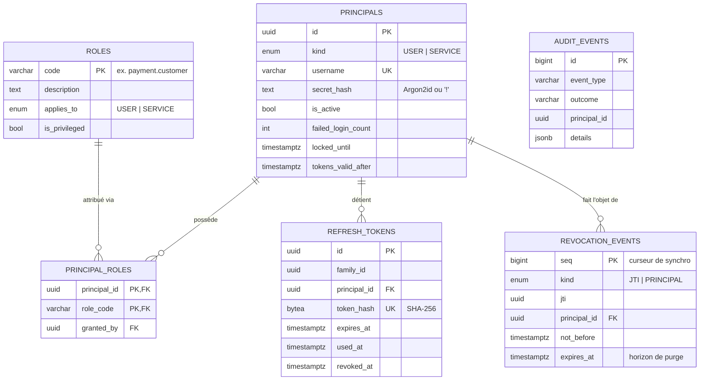
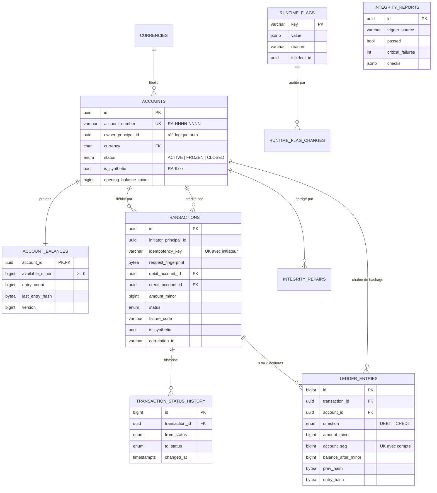
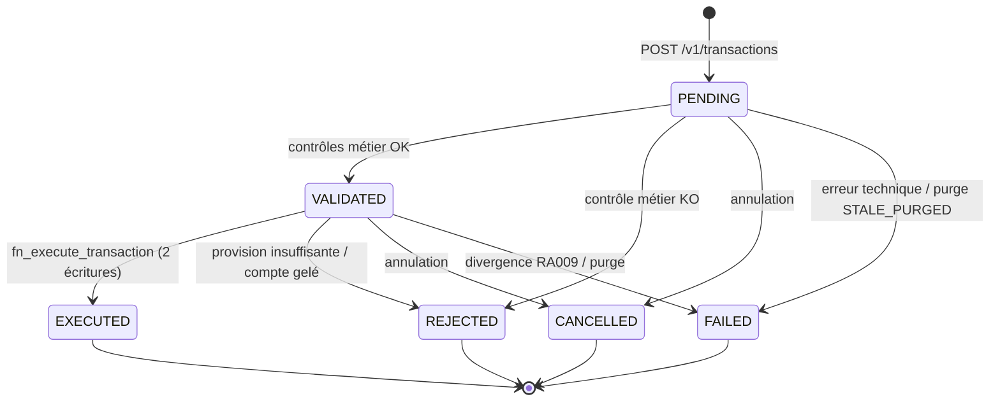
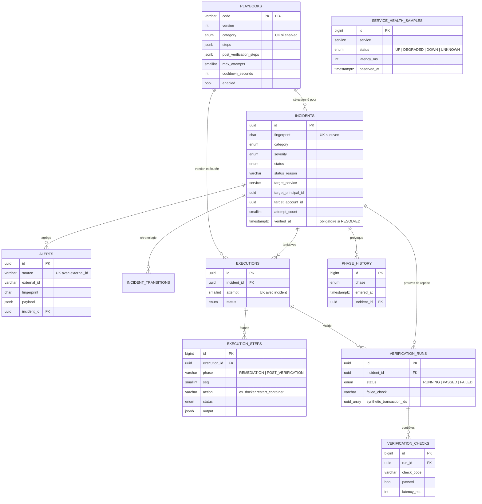

# 02 — Modèle de données (MCD / MPD)

> Implémentation de référence : [database/init/](../database/init/) — PostgreSQL 17.
> Validée par la suite [database/tests/test_invariants.sh](../database/tests/test_invariants.sh) (43 assertions, via [scripts/test-database.sh](../scripts/test-database.sh)).

## 1. Principes

1. **Une base, trois schémas, trois propriétaires fonctionnels** — `auth`, `payment`, `remediation`. Aucun service ne lit le schéma d'un autre : les interactions passent exclusivement par les API. Les références inter-domaines (`owner_principal_id`, `incident_id`…) sont **logiques** (UUID sans FK) pour préserver le découplage et permettre une scission future en bases distinctes.
2. **La base est la dernière ligne de défense** : les invariants financiers et le critère de clôture d'incident sont garantis par contraintes et déclencheurs, même si le code applicatif est défaillant ou compromis.
3. **Append-only par défaut** pour tout ce qui relève de la preuve (grand livre, historiques, audit) — y compris contre le propriétaire et le superutilisateur (hors désactivation explicite des triggers).
4. **Montants en `bigint` d'unités mineures**, jamais de type flottant.

## 2. MCD — schéma `auth`



## 3. MCD — schéma `payment`



### 3.1 Machine à états d'une transaction



Toute autre transition est refusée par la base (SQLSTATE `RA008`). `validated_at` / `executed_at` sont posés exclusivement par les déclencheurs.

### 3.2 Chaîne de hachage du grand livre

Pour chaque compte, l'écriture *n* référence l'empreinte de l'écriture *n-1* :

```
genesis(compte)      = SHA-256("RA-GENESIS|" ‖ account_id)
entry_hash(n)        = SHA-256(prev_hash(n) ‖ "account_id|seq|tx_id|direction|amount|currency|balance_after")
prev_hash(n)         = entry_hash(n-1)   (ou genesis si n = 1)
account_balances     = projection de la dernière écriture (balance_after, seq, entry_hash)
```

Avant toute nouvelle écriture, le déclencheur compare la projection `account_balances` à la queue du grand livre (`v_account_ledger_tail`). Toute divergence (altération directe d'un solde) **bloque l'écriture** avec `RA009` : le système passe en mode *fail-safe* sur le compte concerné, et l'anomalie devient détectable (métrique `ra_ledger_divergence_total`, rapport d'intégrité).

## 4. MCD — schéma `remediation`



## 5. MPD — invariants implémentés

| # | Invariant | Mécanisme | Erreur |
|---|---|---|---|
| I1 | Un solde ne change que via le grand livre | `payment_app` sans `UPDATE` sur `account_balances` ; mise à jour exclusivement par `fn_ledger_before_insert` (`SECURITY DEFINER`) | `permission denied` |
| I2 | Grand livre append-only | Triggers `BEFORE UPDATE/DELETE/TRUNCATE` | `RA006` |
| I3 | Partie double | `UNIQUE(transaction_id, direction)` + contrainte différée `trg_ledger_double_entry` + contrôle à la transition `EXECUTED` | `RA007` |
| I4 | Détection d'altération | Chaîne SHA-256 par compte ; comparaison projection / queue du grand livre avant écriture | `RA009` |
| I5 | Solde ≥ 0, masse monétaire constante | `CHECK` + contrôle `MONEY_CONSERVATION` | `RA003` |
| I6 | États et champs financiers immuables | Triggers de transition + privilèges par colonne | `RA008`, `RA011` |
| I7 | Ségrégation synthétique | `CHECK (is_synthetic = account_number LIKE 'RA-9%')` + contrôle à l'insertion | `RA010` |
| I8 | Idempotence | `UNIQUE(initiator_principal_id, idempotency_key)` + `request_fingerprint` | `23505` → HTTP 409 si payload différent |
| R1 | **Pas de clôture d'incident sans STM réussi** | `fn_incidents_before_update` : dernière `verification_run` = `PASSED` | `RA203` |
| R2 | Un incident ouvert par empreinte | Index unique partiel | `23505` → déduplication |
| R3 | Une exécution active par incident | Index unique partiel `WHERE status='RUNNING'` | `23505` |
| R4 | Un playbook actif par catégorie | Index unique partiel `WHERE enabled` | `23505` |

## 6. Rapport d'intégrité — `payment.fn_integrity_report()`

| Code | Sévérité | Vérifie |
|---|---|---|
| `LEDGER_HASH_CHAIN` | CRITICAL | Séquence continue et empreintes recalculées identiques pour chaque écriture |
| `LEDGER_RUNNING_BALANCE` | CRITICAL | `balance_after` = solde d'ouverture + Σ mouvements |
| `BALANCE_MATCHES_LEDGER` | CRITICAL | Projection `account_balances` conforme à la queue du grand livre |
| `DOUBLE_ENTRY` | CRITICAL | 1 débit + 1 crédit du montant pour chaque `EXECUTED`, aucune écriture sinon |
| `MONEY_CONSERVATION` | CRITICAL | Σ soldes = Σ soldes d'ouverture, par devise |
| `SYNTHETIC_SEGREGATION` | CRITICAL | Aucune transaction ne mélange comptes réels et synthétiques |
| `STALE_IN_FLIGHT` | WARNING | Transactions `PENDING`/`VALIDATED` plus anciennes que le seuil (défaut 5 min) |

Chaque ligne renvoie `passed`, `violations` et un échantillon JSON (≤ 5 éléments) exploitable par la console.

## 7. Restauration de cohérence post-incident

| Fonction | Rôle autorisé | Effet |
|---|---|---|
| `fn_repair_balances(reason, incident_id, dry_run)` | `payment_maint` | Verrouille les soldes, **refuse** (`RA012`) si `LEDGER_HASH_CHAIN` ou `LEDGER_RUNNING_BALANCE` échoue (grand livre compromis ⇒ restauration de sauvegarde, escalade humaine) ; sinon reconstruit la projection depuis le grand livre et trace chaque correction dans `integrity_repairs` |
| `fn_fail_stale_transactions(older_than, reason, incident_id)` | `payment_maint` | Passe en `FAILED/STALE_PURGED` les transactions bloquées en vol (jamais de suppression) ; seuil minimal 60 s |
| `UPDATE runtime_flags` | `payment_maint` | Reconfiguration à chaud (`write_mode`, plafonds) ; chaque changement est historisé dans `runtime_flag_changes` |
| `fn_lab_tamper_balance(account, delta)` | `payment_maint` | **Laboratoire uniquement** (`CHAOS_LAB_ENABLED=true`) : altère un solde sans écriture pour simuler l'attaque |

## 8. Rôles PostgreSQL

| Rôle | Login | Privilèges |
|---|---|---|
| `ra_owner` | non | Propriétaire de tous les objets ; utilisé seulement par les scripts de migration (`SET ROLE`) |
| `auth_app` | oui | `auth.*` selon besoin, colonnes modifiables limitées, audit en insertion seule |
| `payment_app` | oui | Lecture `payment.*`, `INSERT` transactions, `UPDATE(status, failure_code, failure_reason)`, `EXECUTE fn_execute_transaction / fn_integrity_report` |
| `payment_maint` | oui | Lecture `payment.*`, flags, gel de comptes, fonctions de réparation/purge |
| `remediation_app` | oui | `remediation.*` (colonnes modifiables limitées), aucun accès `auth`/`payment` |

Chaque rôle a des garde-fous de session (`statement_timeout`, `lock_timeout`, `idle_in_transaction_session_timeout`, `CONNECTION LIMIT`). Les mots de passe sont injectés au premier démarrage par `\getenv`, chiffrés en SCRAM-SHA-256.
