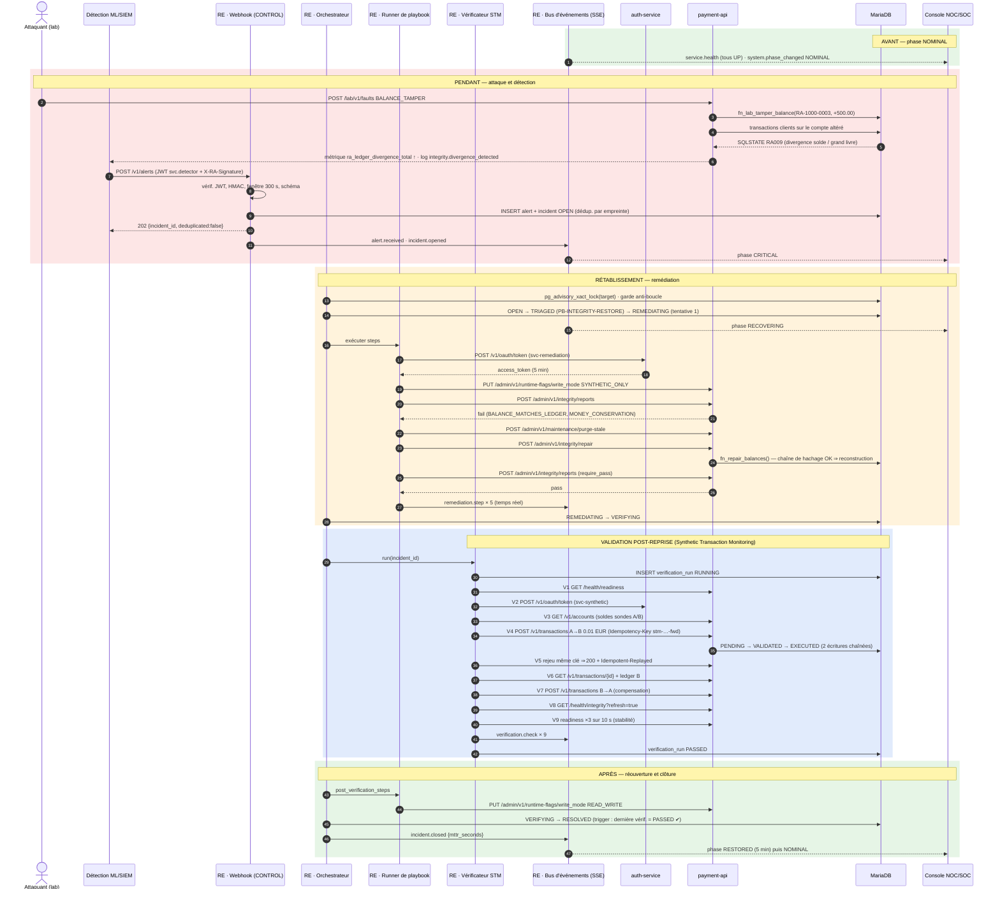
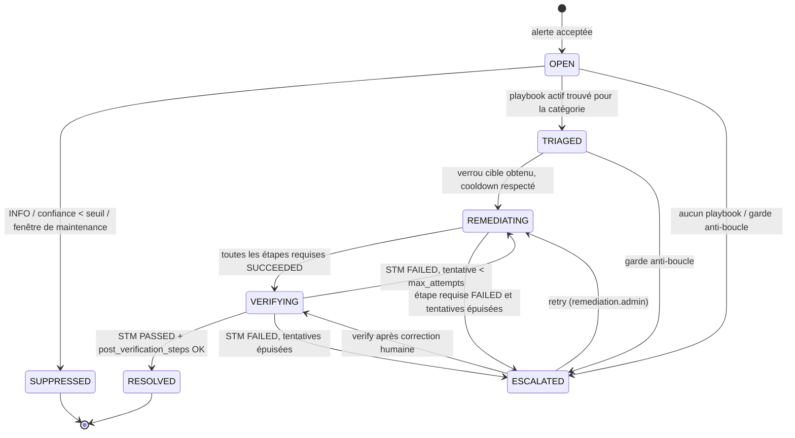

# 04 — Boucle de remédiation et validation post-reprise

## 1. Diagramme de séquence — scénario de référence

Scénario : altération directe d'un solde (attaque sur la couche de données), détectée par le moteur ML, corrigée et **prouvée** rétablie sans intervention humaine.



## 2. Machine à états d'un incident



La transition `→ RESOLVED` est **refusée par la base** (SQLSTATE `RA203`) tant que la dernière `verification_run` de l'incident n'est pas `PASSED`. Même un bug ou une compromission du moteur ne peut donc pas déclarer un incident clos sans preuve de reprise fonctionnelle.

## 3. Algorithme de l'orchestrateur

```text
on alert_persisted(incident):
    if incident.status == SUPPRESSED: return
    with advisory_lock(hash(incident.target_service)):           # une remédiation à la fois par cible
        if loop_guard_tripped(target):                           # > REMEDIATION_MAX_PER_TARGET_PER_HOUR (défaut 5)
            → ESCALATED("remediation loop guard"); return
        playbook = active_playbook(incident.category)
        if playbook is None: → ESCALATED("no playbook"); return
        → TRIAGED(playbook)
        wait cooldown(playbook, target)                          # depuis la dernière exécution sur la cible
        for attempt in 1..playbook.max_attempts:
            → REMEDIATING(attempt)
            exec = run_steps(playbook.steps)                     # timeout par étape, retry réseau ×2 (backoff 0,5 s/1 s)
            if exec.failed and not last attempt: continue
            if exec.failed: → ESCALATED(exec.error); return
            → VERIFYING
            run = synthetic_verification(incident)
            if run.passed:
                post = run_steps(playbook.post_verification_steps)
                if post.failed: → ESCALATED("post-verification step failed"); return
                → RESOLVED                                       # garde RA203 côté base
                return
        → ESCALATED("verification failed after max attempts")
```

Règles d'exécution des étapes :

* **Résolution des gabarits** (`{{incident.target_service}}`, `{{incident.target_principal_id}}`…) ; une cible non résolue rend l'étape `SKIPPED` si `"optional": true`, sinon `FAILED`.
* **Idempotence** : toute action est sûre à rejouer (redémarrage, positionnement de flag, réparation, révocation).
* **Allowlist** des actions : le runner refuse toute `action` absente du registre de connecteurs (validation Pydantic à l'amorçage du catalogue).
* **Redémarrage** limité aux conteneurs portant le label `resilience.remediable=true` (`auth-service`, `payment-api`) ; `database` et `remediation-engine` ne sont jamais redémarrés automatiquement.
* **Reprise après crash du moteur** : au démarrage, toute exécution `RUNNING` est passée `ABORTED` et l'incident repris au début de la tentative suivante.

### Registre des connecteurs

| Action | Appel | Identité |
|---|---|---|
| `docker.restart_container` | `POST socket-proxy/containers/{name}/restart?t=10` | réseau `docker-ctl` |
| `probe.wait_ready` | `GET {service}/health/readiness` jusqu'à `pass` | — |
| `payment.set_write_mode` | `PUT /admin/v1/runtime-flags/write_mode` | `svc.remediation` |
| `payment.set_runtime_flag` | `PUT /admin/v1/runtime-flags/{key}` | `svc.remediation` |
| `payment.integrity_report` | `POST /admin/v1/integrity/reports` | `svc.remediation` |
| `payment.repair_balances` | `POST /admin/v1/integrity/repair` | `svc.remediation` |
| `payment.purge_stale` | `POST /admin/v1/maintenance/purge-stale` | `svc.remediation` |
| `payment.freeze_account` | `POST /admin/v1/accounts/{id}/freeze` | `svc.remediation` |
| `auth.revoke_principal_tokens` | `POST /internal/v1/principals/{id}/revoke-tokens` | `svc.remediation` |
| `auth.disable_principal` | `POST /internal/v1/principals/{id}/disable` | `svc.remediation` |

## 4. Protocole de validation post-reprise (STM)

**Un redémarrage réussi ne suffit jamais.** Le vérificateur exécute séquentiellement les contrôles ci-dessous, avec son **identité dédiée** `svc-synthetic` (distincte de `svc-remediation` : le moteur ne valide pas sa propre réparation avec ses propres privilèges). Le premier échec arrête la séquence : `FAILED` + `failed_check`.

| # | `check_code` | Prouve que… | Critère de succès |
|---|---|---|---|
| V1 | `API_READINESS` | l'API est joignable et ses dépendances prêtes | `GET /health/readiness` = `200`, latence < 1 000 ms |
| V2 | `AUTH_M2M_TOKEN` | l'authentification fonctionne | `client_credentials` → jeton valide, `aud` = `payment-api` |
| V3 | `SYNTHETIC_BALANCES_READ` | la lecture des données fonctionne | soldes A et B lus |
| V4 | `SYNTHETIC_TX_EXECUTE` | **le traitement métier est fonctionnel** | `POST /v1/transactions` A→B 0,01 EUR ⇒ `201`, `status = EXECUTED`, < 2 000 ms |
| V5 | `IDEMPOTENCY_REPLAY` | l'idempotence est intacte | rejeu même clé ⇒ `200`, `Idempotent-Replayed: true`, même `id` |
| V6 | `TX_READ_BACK` | la persistance et l'historisation sont cohérentes | `GET` ⇒ historique `PENDING>VALIDATED>EXECUTED` ; écriture CREDIT présente au grand livre de B ; soldes A −1, B +1 |
| V7 | `SYNTHETIC_TX_COMPENSATE` | les sondes restent stables | B→A 0,01 EUR `EXECUTED` ; soldes revenus à l'état V3 |
| V8 | `DATA_INTEGRITY` | **la base est intègre** | `GET /health/integrity?refresh=true` = `pass` (tous contrôles CRITICAL) |
| V9 | `STABILITY_WINDOW` | la reprise n'est pas transitoire | 3 readiness `pass` consécutives sur 10 s |

Clés d'idempotence : `stm-{run_id}-fwd` et `stm-{run_id}-rev`. Chaque requête porte `X-Correlation-ID: <incident_id>`. En mode `SYNTHETIC_ONLY`, seuls ces flux sont admis : la plateforme est **prouvée fonctionnelle avant d'être rouverte** au trafic réel par `post_verification_steps`.

Un STM planifié (`trigger_source = SCHEDULED`, toutes les 60 s lorsqu'aucun incident n'est ouvert) fournit en outre une ligne de base et une détection précoce indépendante du moteur ML.

### 4.1 Détection de secours intégrée (watchdog)

Le moteur ne dépend pas exclusivement du lot Détection : il émet lui-même des alertes (source `watchdog`, confiance 1.0) qui suivent exactement le même circuit que le webhook (idempotence, déduplication, playbooks, vérification).

| Déclencheur | Alerte émise | Playbook |
|---|---|---|
| Service sondé en échec `REMEDIATION_WATCHDOG_DOWN_POLLS` fois de suite (défaut 3 × 5 s) | `SERVICE_UNAVAILABLE` / service concerné / `CRITICAL` | `PB-SERVICE-RESTART` |
| STM planifiée en échec sur `DATA_INTEGRITY` | `DATA_INTEGRITY_VIOLATION` / `payment-api` / `CRITICAL` | `PB-INTEGRITY-RESTORE` |
| STM planifiée en échec sur `AUTH_M2M_TOKEN` | `SERVICE_UNAVAILABLE` / `auth-service` / `CRITICAL` | `PB-SERVICE-RESTART` |
| STM planifiée en échec sur un autre contrôle | `SERVICE_UNAVAILABLE` / `payment-api` / `HIGH` | `PB-SERVICE-RESTART` |

L'empreinte dérivée (`catégorie | service`) étant identique à celle d'une alerte externe sans cible fine, une alerte du détecteur ML et celle du watchdog portant sur le même problème fusionnent en un seul incident. Scénario validé de bout en bout : altération d'un solde **sans aucune alerte externe** → STM planifiée en échec → incident watchdog → réparation → vérification → clôture automatique.

## 5. Calcul de la phase système (vue Avant / Pendant / Après)

Évalué à chaque événement (alerte, transition, échantillon de santé) ; toute variation produit une ligne `phase_history` et un événement `system.phase_changed`.

| Priorité | Condition | Phase | Lecture console |
|---|---|---|---|
| 1 | Incident `ESCALATED` ouvert, ou incident `OPEN`/`TRIAGED` de sévérité `CRITICAL`, ou service `DOWN` sans remédiation en cours | `CRITICAL` | **PENDANT** |
| 2 | Incident `REMEDIATING` / `VERIFYING` | `RECOVERING` | **PENDANT → APRÈS** |
| 3 | Incident `OPEN`/`TRIAGED` (`WARNING`/`HIGH`) ou service `DEGRADED` | `DEGRADED` | **PENDANT** |
| 4 | Dernier incident `RESOLVED` depuis < `RESTORED_HOLD_SECONDS` (300 s) et tous services `UP` | `RESTORED` | **APRÈS** |
| 5 | Sinon | `NOMINAL` | **AVANT** |

Sondes de santé : `GET /health/readiness` de chaque service toutes les 5 s (timeout 2 s) ; `DOWN` = échec réseau ou `503` ×2 consécutifs ; `DEGRADED` = `warn` ou latence > 500 ms.

## 6. Modes de défaillance et réponse

| Situation | Comportement |
|---|---|
| Rafale d'alertes identiques | Dédupliquées par empreinte (un seul incident, `alert_count` incrémenté) |
| Alertes de catégories différentes sur la même cible | Incidents distincts, sérialisés par verrou consultatif sur la cible |
| Remédiation qui « réussit » mais service toujours KO | STM `FAILED` ⇒ nouvelle tentative, puis `ESCALATED` |
| Grand livre lui-même altéré (chaîne de hachage rompue) | `repair` refusé (`RA012`) ⇒ `ESCALATED` — restauration de sauvegarde requise (décision humaine) ; la plateforme reste en `SYNTHETIC_ONLY` |
| auth-service indisponible | Le jeton M2M en cache (≤ 5 min) est utilisé ; sinon `PB-SERVICE-RESTART` sur auth-service ; STM V2 échoue tant qu'il n'est pas rétabli |
| Boucle redémarrage/panne | Garde anti-boucle (5 remédiations/h/cible) ⇒ `ESCALATED` |
| Redémarrage du moteur pendant une exécution | Exécution `ABORTED` et vérification `FAILED/ENGINE_RESTART` au démarrage, reprise à la tentative suivante (validé par `SIGKILL` du moteur en pleine vérification : tentative 2 → `RESOLVED`) |
| Panne injectée par un autre acteur (crash, pool épuisé) | Détectée par le watchdog sans alerte externe, réparée et vérifiée (observé pendant les tests `payment-api` : clôture en 23 s) |
| Webhook rejoué par la détection | Réponse idempotente, aucun nouvel incident |
| Détecteur compromis émettant de fausses alertes | Actions bornées par l'allowlist, non destructives et réversibles ; principaux `SERVICE` et `admin` non désactivables ; base et moteur jamais redémarrés |
